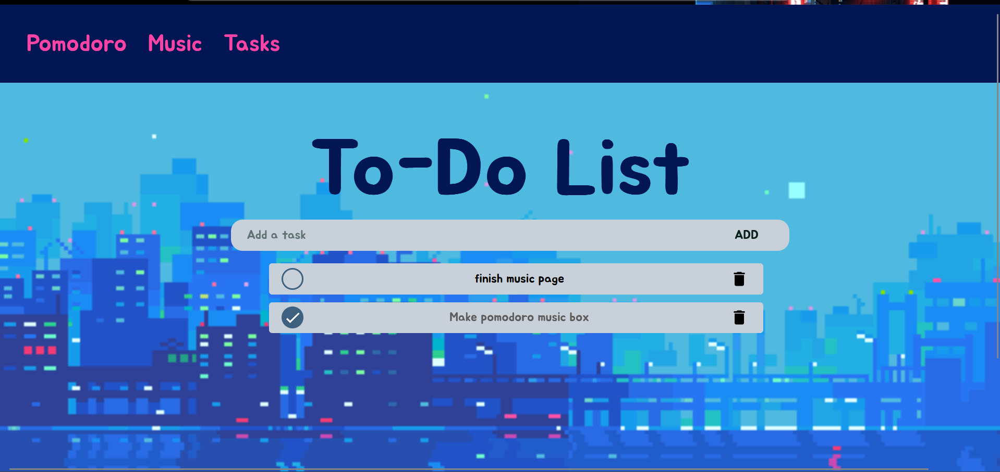

# MikuTrack
MikuTrack is a miku style website that contains a pomodoro time tracker for 25 minutes, a music jukebox that you can add your own music and a task to-do list tracker.

## Description:
A web app that help you study and stay in track. It has a pomodoro tracker, To-do list, and a jukebox for your music. Done with Java Script, HTML, and CSS on VSCode. 
## Screenshots:

 

## Getting Started:

### Executing Program:
- link to open it: https://vmxorphic.github.io/MikuTrack/
  
- To run the website locally download the repo and open the index.html. It can be opened in files or on Vscode though the live server extension.
  
## Help:
There are no common problems for MikuTrack.
To add songs/play songs you need to grab a certain link on Spotify. Go to artist/playlist/album/song click share and copy link, that's what the music.js uses to load the music.  
Some alerts may go of it you try to paste an incompatible link to the music input or when the timer goes ends (will automatically restart)
## License:
This project is under the MIT license.

## Other:
This project was done for a program on Hack Club called Pixl.
